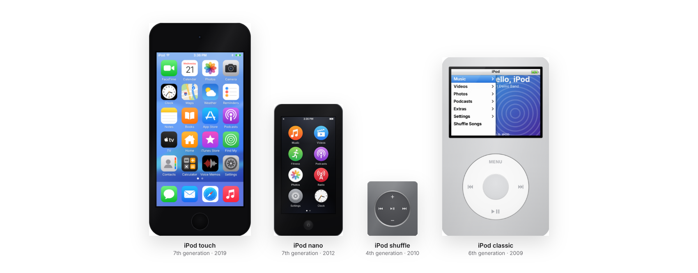
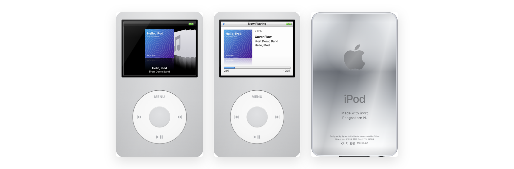
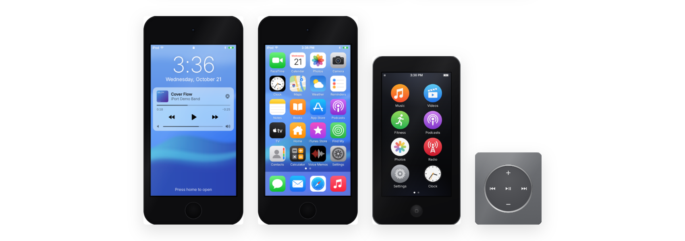
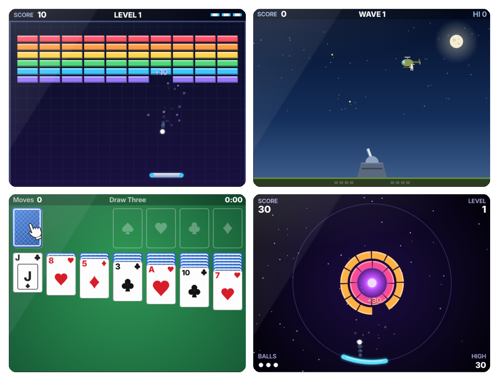
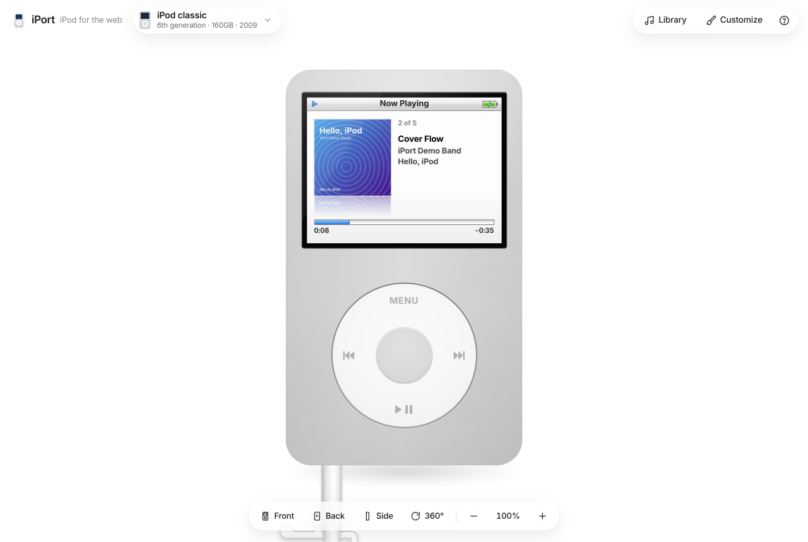
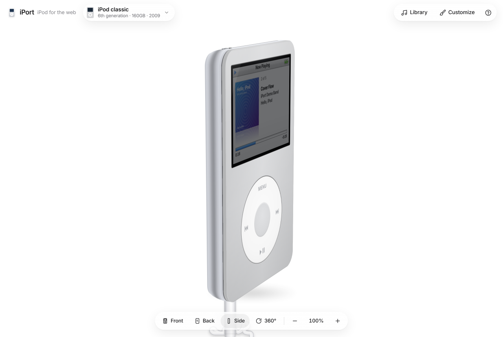
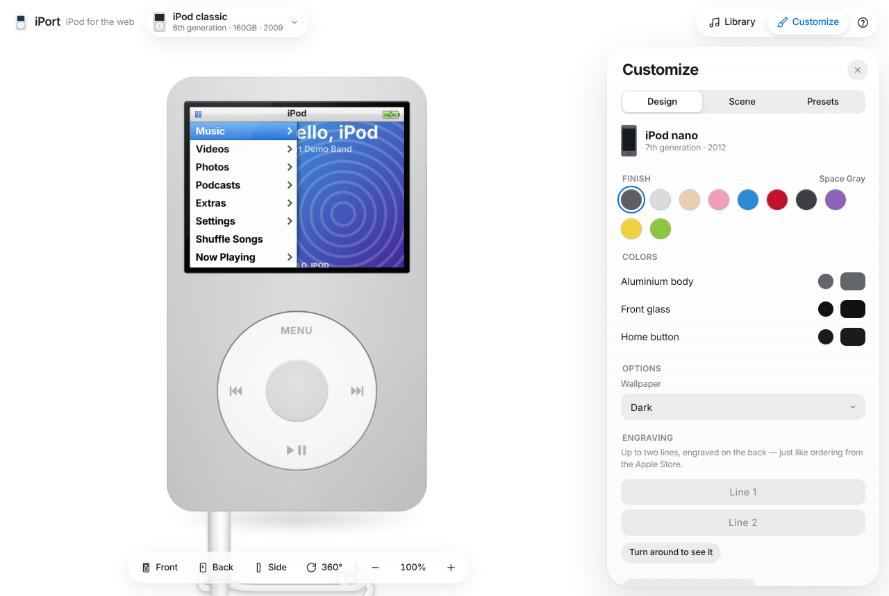
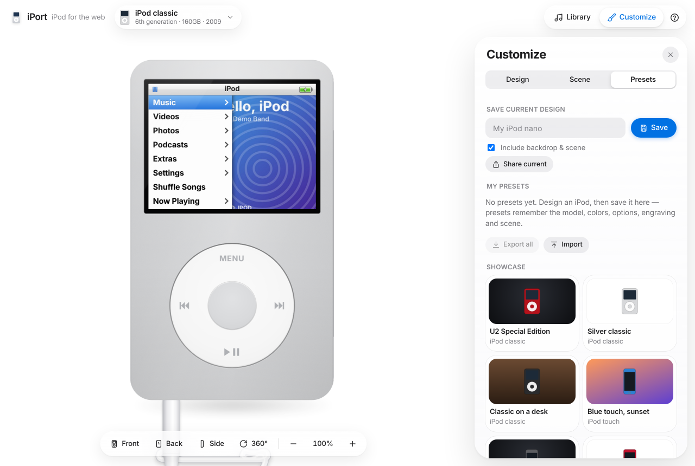
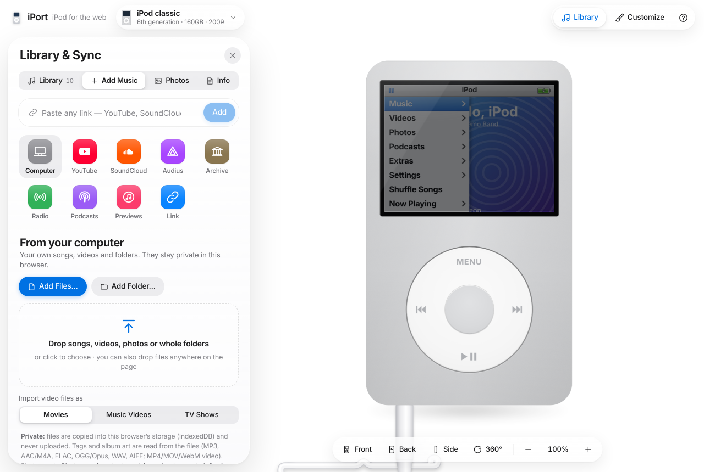

# iPort — iPod for the web

A faithful iPod simulator that runs in your browser. Pick a model, load your own
music (or stream from YouTube, SoundCloud and free sources), spin it around in
3D, and design your own colorway.



**Current version:** 1.0.0 · see [CHANGELOG.md](CHANGELOG.md)

## Models

| Model | Year | Highlights |
| --- | --- | --- |
| iPod touch (7th generation) | 2019 | Lock screen, home screen, Control Center, app switcher, Music with synced lyrics, Podcasts, TV, Photos, Camera, Clock, Calculator, Notes, Calendar, Contacts, Voice Memos, Weather, Settings, iTunes Store previews |
| iPod nano (7th generation) | 2012 | Circular app icons, Music, Videos that turn the iPod sideways, FM-style Radio, Fitness, Photos, Clock, Podcasts, iTunes U |
| iPod shuffle (4th generation) | 2010 | Clickable control pad, three-way switch, status light, VoiceOver with spoken playlists |
| iPod classic (6th generation, 160GB) | 2009 | Click Wheel, Cover Flow, Now Playing with Genius and lyrics, On-The-Go, Extras, full Settings, five games |
| iPod (5th generation, "iPod video", 30GB) | 2005 | Glossy white or black front (and the U2 Special Edition), headphone jack on top, the Click Wheel software from before Cover Flow and Genius |

### iPod classic

Cover Flow, Now Playing and the polished steel back with your own engraving.



### iPod touch, nano and shuffle



### Click Wheel games

Brick, Parachute, Solitaire and Vortex (plus Music Quiz) under Extras ▸ Games on the iPod classic.



## Features

### EarPods that plug in

Press play and an EarPods cable rises from the bottom of the window and clicks
into the headphone jack. The cable is a physics simulation: it sags, swings when
you turn the iPod, and you can grab it. Pull the plug out and the music pauses,
just like a real iPod.



### Real 3D

Drag the background to spin the iPod, scroll to zoom, or use Front, Back, Side
and 360°: move the pointer to the right edge of the window and they slide in
(along the bottom on phones).



### Make it yours

Every colored part, the materials, wallpapers, screen theme, engraving on the
back and the backdrop. Put it in a silicone, leather or clear case, or in one
of Apple's knitted iPod Socks, and cover the back in stickers and engraved
text wherever you like. Save a design as a preset, share it as a link, or export
all your presets to a file.





### Your music, from anywhere

- **Your own files:** MP3, AAC/M4A, FLAC, WAV, OGG and video. Tags and album art
  are read in the browser and kept in IndexedDB; nothing is uploaded. Drag files
  anywhere onto the page.
- **YouTube and SoundCloud:** paste a link or search, played through their
  official embedded players.
- **Free sources:** Audius, the Internet Archive, internet radio
  (radio-browser.info), podcasts, 30-second iTunes previews and direct links.



### Everything else

- One shared player: switching models keeps the music playing, and the queue and
  position are remembered between visits.
- Equalizer with all iPod presets, Sound Check, synced lyrics, sleep timer,
  alarms, and keyboard / lock-screen media keys.
- Works on phones and installs as a web app.

## Develop

```bash
npm install
npm run dev        # http://localhost:5173  (?model=classic|video5|touch7|nano7|shuffle4)
npm run build      # type-check + production build into dist/
npm test           # unit tests
```

Requires Node 20.19+ or 22.12+. `npm run dev` also serves the functions in `api/`
(YouTube search, podcast feed proxy and so on), so every source works locally.

See [docs/ARCHITECTURE.md](docs/ARCHITECTURE.md) for how the code is organised.

## Versioning

iPort follows [Semantic Versioning](https://semver.org/):

- **MAJOR** (2.0.0): something users relied on changes or goes away.
- **MINOR** (1.1.0): new features that keep everything working.
- **PATCH** (1.0.1): bug fixes and polish.

The app shows its version and build in the Help panel (?) and in the logo's tooltip.

To release:

1. Move the notes under **Unreleased** in [CHANGELOG.md](CHANGELOG.md) to a new
   version heading and commit.
2. Run `npm run release:patch`, `npm run release:minor` or `npm run release:major`.
   This bumps `package.json`, commits "Release vX.Y.Z" and creates the `vX.Y.Z` tag.
3. Push the commit and the tag: `git push && git push --tags`.

## License and copyright

Copyright © 2026 Pongsakorn Naklang. All rights reserved.

iPort is proprietary software: no license is granted to copy, modify,
redistribute or host it without written permission. See [LICENSE](LICENSE).
Open-source components keep their own licenses; see
[THIRD-PARTY-NOTICES.md](THIRD-PARTY-NOTICES.md).

Apple, the Apple logo, iPod, iPod classic, iPod nano, iPod shuffle, iPod touch,
Click Wheel, Cover Flow, EarPods, iTunes and iOS are trademarks of Apple Inc.
iPort is an independent fan project and is not affiliated with, sponsored or
endorsed by Apple Inc. All graphics are drawn from scratch with CSS and SVG.
